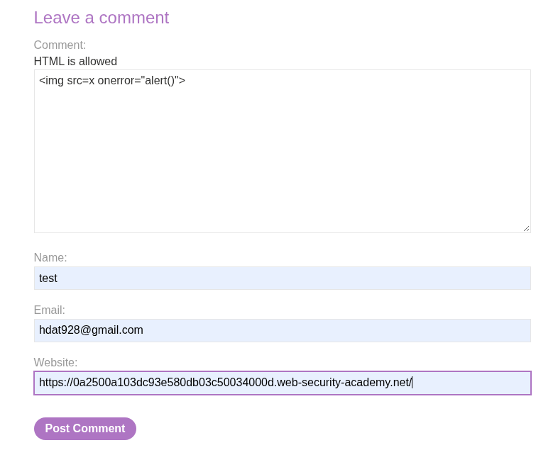
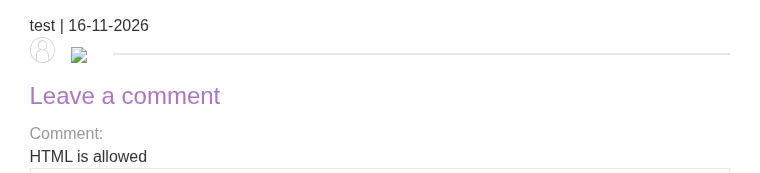
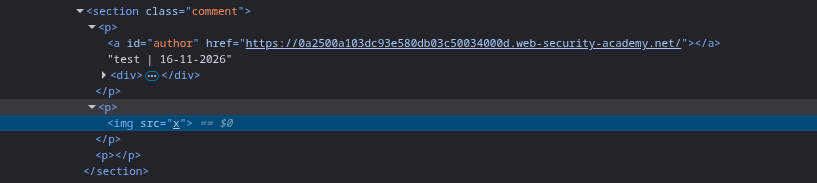
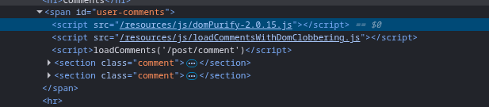
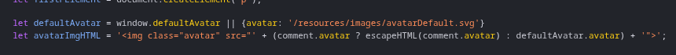
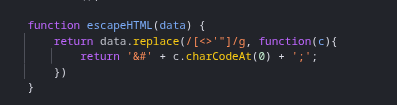

# Exploiting DOM clobbering to enable XSS
## Description
This lab contains a DOM-clobbering vulnerability. The comment functionality allows "safe" HTML. To solve this lab, construct an HTML injection that clobbers a variable and uses XSS to call the alert() function.
## Steps:
First, i focus on the name of the lab. So i researched about DOM-cloberring definition and knew that DOM clobbering is a web security vulnerability where HTML elements with specific id or name attributes can be overwritten JavaScript variables or DOM properties.

Back to the lab. I tried a basic XSS payload because the information shows that there are a comment functionality allow HTML so I used this payload
```jsx

```


The result is that cannot work, so I try to find the reason and find out the event handler in my payload was disappear.


I see there are 2 Javascript files and the reason the event handle was gone is a libary called DomPurify. It is an open-source XSS sanitizer designed to clean user‑supplied or third‑party HTML before inserting it into the DOM. It removes dangerous tags, attributes, and scripts, ensuring safe rendering in browsers.

See that i cannot use dangerouse attributes so I read the Javascript file that has a comment-loading functionality. There are a field that not effected by DomPurify

The meaning of this code:
If window.defaultAvatar exist => use it
Else => use default object with avatar property

Focus on comment.avatar it was a function that prevent attacker escape HTML element but window.defaultAvatar.avatar is not handled by the same way. So we can exploit it.
I try to create two element with id="test" to test before completed a payload
```jsx
document.body.innerHTML += '<a id="test" name="x" href="hello"><a id="test">';
```
